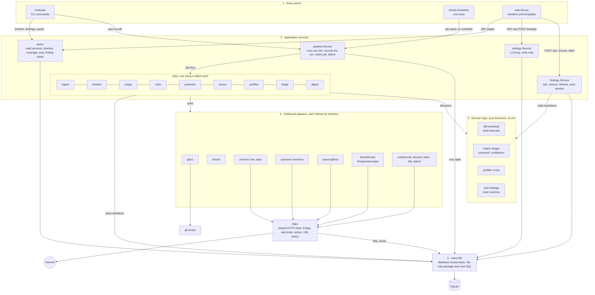
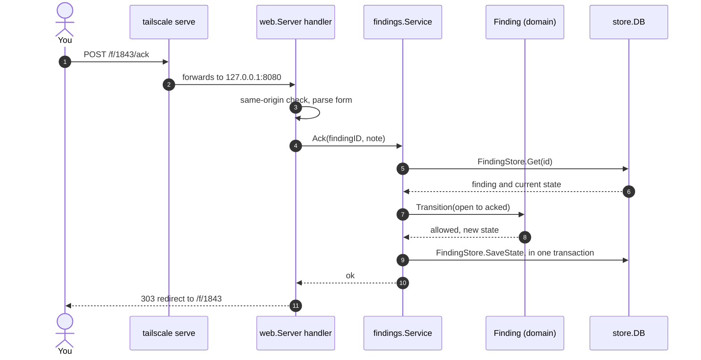
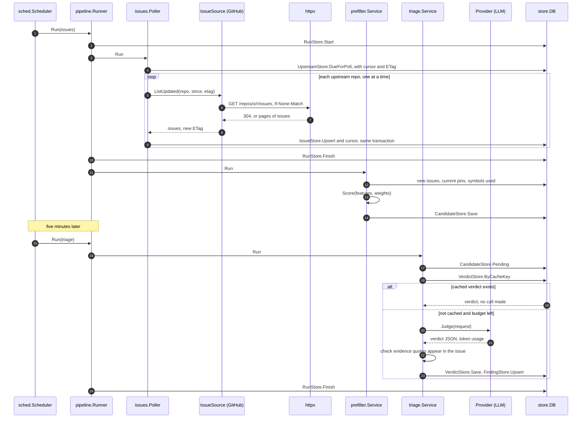

# Architecture

This document shows how upstreamwatch is put together: what sits outside the binary, the layers inside it, what each job does, and how two typical requests travel through the code. It follows [the plan](../mvp-plan/PLAN.md); where the design differs from the plan, the difference is listed in [decisions.md](decisions.md).

upstreamwatch ships as one Go binary, `upw`, with three ways in, a set of jobs in the middle, and one package that owns the database.

## System context

You reach `upw` over the tailnet or by SSH. Everything else is the binary calling out; nothing on the internet can call in. All outside calls are read-only except the digest (email, webhook or ntfy) and the LLM request. Each outside service is described in [external-sources.md](external-sources.md).

Two tokens keep the private side and the public side apart: one can read the target repos, the other has no repository access and only raises the GitHub rate limit for public upstreams.

The LLM key comes from the `UPW_LLM_API_KEY` environment variable or from the settings page in the web UI. The variable wins if both are set. `cmd/upw` hands each provider adapter a `KeySource` that applies that rule; `settings.Service` is the only code that encrypts and decrypts the stored key. See [data-access.md](data-access.md) for how the key is stored.

## Layers

There are three entry points: the CLI, the cron scheduler and the HTTP server. None of them contains logic. Each one turns its input into a call on an application service. Services hold the workflow, call pure domain functions for the decisions, and reach the outside world and the database only through interfaces.

The diagram is a component diagram (the C4 model calls this level "components"). The two sequence diagrams further down show individual requests.

Arrows point in the direction of the call. Nothing in layers 3 to 5 calls upward, and adapters never call each other or the store directly; a service always sits between them.

The email notifier is the one adapter that does not go through `httpx`. It speaks SMTP with the standard library. See [interfaces.md](interfaces.md).

## Packages

Every package under `internal/`, plus `cmd/upw`. The layer numbers are those of the diagram above. `config`, `httpx`, `llm` and `testutil` are not numbered boxes in it: `httpx` is drawn between layers 4 and 5, `llm` is a pure helper package used by `triage` and the two LLM adapters, and `config` and `testutil` are not drawn.

| Package | Layer | What it owns |
|---|---|---|
| `cmd/upw` | 1 Entry | The CLI commands; turns arguments into service calls. |
| `internal/sched` | 1 Entry | Cron ticks; hands job names to `pipeline.Runner`. |
| `internal/web` | 1 Entry | HTTP handlers and templates; no logic. |
| `internal/pipeline` | 2 Service | `Runner` and the `Job` interface: runs one job, records the run, raises `job_failure`. |
| `internal/ingest` | 2 Service (job) | Target repo registration and the URL and host policy. |
| `internal/timeline` | 2 Service (job) | Manifest history into dependency events and intervals. |
| `internal/usage` | 2 Service (job) | The symbol-usage index. Adapters are the two packages below. |
| `internal/usage/golang` | 4 Adapter | `UsageIndexer` for Go source, using `go/parser`. |
| `internal/usage/python` | 4 Adapter | `UsageIndexer` for Python source, by import scan. |
| `internal/vuln` | 2 Service (job) | Advisory matching, exposure window and confidence. Adapters in `vuln/osv`, `vuln/kev`, `vuln/epss`. |
| `internal/upstream` | 2 Service (job) | Package to upstream repo resolution, first resolver wins. Resolvers are subpackages. |
| `internal/issues` | 2 Service (job) | `Poller`: upstream issues and comments with cursors. Adapter in `issues/github`. |
| `internal/prefilter` | 2 Service (job) | Feature extraction and weighted score for issue candidates. |
| `internal/triage` | 2 Service (job) | `Service` and the `Provider` interface: cache key, budget, evidence check, verdicts. May import `internal/llm`. |
| `internal/report` | 2 Service (job) | The digest: ranking, what changed, and the `Notifier` interface. |
| `internal/ops` | 2 Service (job) | `Backup`. |
| `internal/findings` | 2 Service | Ack, snooze, dismiss and auto-resolve. |
| `internal/settings` | 2 Service | The LLM key, write-only. The only code that encrypts and decrypts it, and the only user of `SettingsStore`. |
| `internal/eval` | 2 Service | Eval labels, runs and reports. It declares its own small interface for "judge this candidate", which `triage.Service` satisfies; `cmd/upw` wires them. It imports `model` only and never calls a provider. |
| `internal/query` | 2 Service | The read services behind the web pages and the read-only CLI commands: timeline, coverage, finding detail, eval report. Imports `model` and declares the store interfaces it needs. |
| `internal/model` | 3 Domain | Shared objects and their pure rules, plus `Scope` and `Stats`. See [domain-model.md](domain-model.md). |
| `internal/gitsrc` | 4 Adapter | `GitSource` over the `git` binary; the only `os/exec` user. |
| `internal/extract` | 4 Adapter | `Extractor` implementations (manifests library, Unity). |
| `internal/llm` | Pure helper, beside 4 | Provider-neutral prompt builder, vocabulary constants, output schema and cost helpers. No I/O; imports `model` only. `triage` and the two adapters below may import it. |
| `internal/llm/anthropic` | 4 Adapter | `Provider` using the Anthropic SDK. May import `llm`, `httpx` and `model`. Built with a `KeySource`. |
| `internal/llm/openaicompat` | 4 Adapter | `Provider` for OpenAI-compatible chat endpoints (config value `openai_compat`). May import `llm`, `httpx` and `model`. Built with a `KeySource`. |
| `internal/notify/email`, `discord`, `slack`, `ntfy`, `stdout` | 4 Adapter | One `Notifier` each. |
| `internal/httpx` | between 4 and 5 | Shared HTTP client: ETags, rate limits, retries, URL policy. |
| `internal/store` | 5 Store | `store.DB`, the migrations, transactions; the only `database/sql` user. |
| `internal/config` | not drawn | Config loading, defaults and validation; only `cmd/upw` imports it. Default listen address `127.0.0.1:8080`; the container config sets `0.0.0.0:8080`. |
| `internal/testutil` | not drawn | Test helpers such as the fixture git repo builder; no production package imports it. |

Every interface is declared in the package that uses it, so `Provider` is in `internal/triage`, not in `internal/llm`, and eval's "judge this candidate" interface is in `internal/eval`.

## What each job does

Each row is one job: the service that implements it, the pure decisions it makes, what it calls out through, and the tables it writes. Tables are described in [database.md](database.md) and the store interfaces in [data-access.md](data-access.md).

| Job | Service object | Decisions (pure) | Calls out through | Writes tables |
|---|---|---|---|---|
| ingest | `ingest.Service` | URL and host policy | `GitSource` | repos |
| timeline | `timeline.Service` | diff manifest states into events; fold events into intervals | `GitSource`, `Extractor` | commits, manifests, packages, dep_events, dep_versions |
| usage | `usage.Service` | none | `GitSource`, `UsageIndexer` | symbol_usage |
| vulns | `vuln.Service` | version in range; exposure window; confidence label | `AdvisorySource`, `ExploitSignals` | advisories, advisory_affected, advisory_matches, findings |
| upstream | `upstream.Service` | resolver order, first hit wins | `UpstreamResolver` chain | upstream_repos, package_upstream |
| issues | `issues.Poller` | cursor and backfill bounds | `IssueSource` | upstream_issues, upstream_issue_comments, cursors on upstream_repos |
| prefilter | `prefilter.Service` | feature extraction and weighted score | nothing external | issue_candidates |
| triage | `triage.Service` | cache key; budget; evidence is a real quote | `Provider` | llm_verdicts, findings |
| digest | `report.Service` | ranking; what changed since last digest | `Notifier` (every enabled one) | findings, digests |
| backup | `ops.Backup` | retention | store only | backup file |

## Entry points

### HTTP routes

| HTTP route | Handled by |
|---|---|
| `GET /` | findings list (read) |
| `GET /f/{id}` | finding detail (read) |
| `POST /f/{id}/ack\|snooze\|dismiss` | `findings.Service` |
| `POST /f/{id}/label` | `eval.Service` |
| `GET /repos/{slug}` | timeline (read) |
| `GET /coverage` | coverage (read) |
| `GET /eval` | eval report (read) |
| `GET /settings`, `POST /settings` | `settings.Service` (LLM key, write-only; scheduled with the LLM milestone, M4) |
| `GET /health` | last runs, JSON |

The settings page never shows the stored key. It shows the last four characters only.

### CLI

| CLI | Handled by |
|---|---|
| `upw serve` | starts Scheduler and web.Server |
| `upw run <job>`, `run all --once` | `pipeline.Runner` |
| `upw timeline`, `findings` | `internal/query` |
| `upw llm estimate\|rejudge` | `triage.Service` |
| `upw eval run\|report\|import` | `eval.Service` (`import` imports labels) |
| `upw export verdicts\|labels\|state` | store export; one kind per invocation, written to stdout. `upw eval export` is an alias of `upw export labels` |
| `upw doctor` | each outbound adapter's `Check` (the `Checker` interface in [interfaces.md](interfaces.md)) |

### Schedules

| Schedule | Jobs run in order |
|---|---|
| every 6 h | ingest, timeline, usage, upstream |
| every 6 h, +5 min | vulns |
| hourly | issues, prefilter |
| hourly, +5 min | triage |
| 08:00 daily | digest |
| 03:30 daily | backup |

## Two requests, followed end to end

### You acknowledge a finding in the browser

The handler never touches SQL and never decides whether a transition is legal. The rule lives on the domain object so the CLI and the digest get the same answer.

### The hourly tick finds a new upstream issue and judges it

A failed job is caught by the Runner, written to the runs table and raised as a job_failure finding, so it shows up in the next digest instead of failing quietly.
