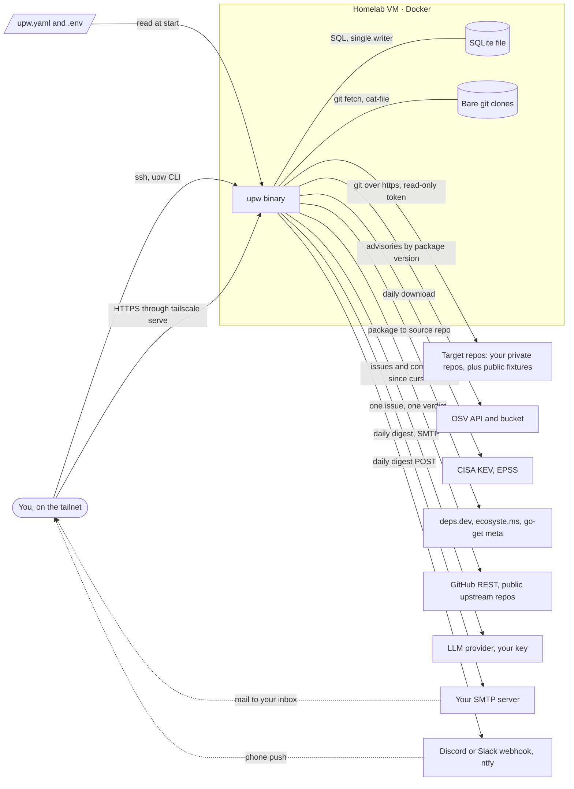
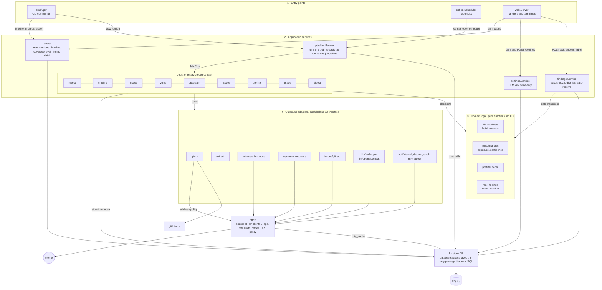
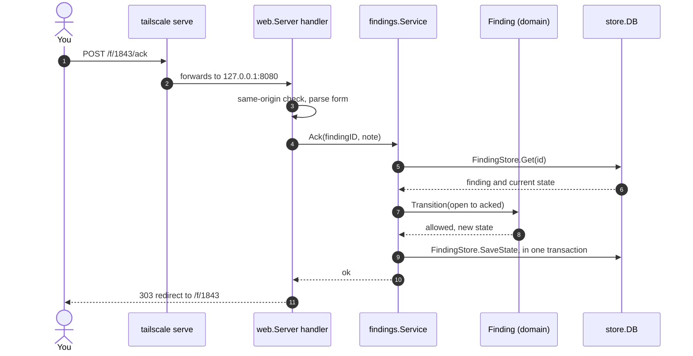
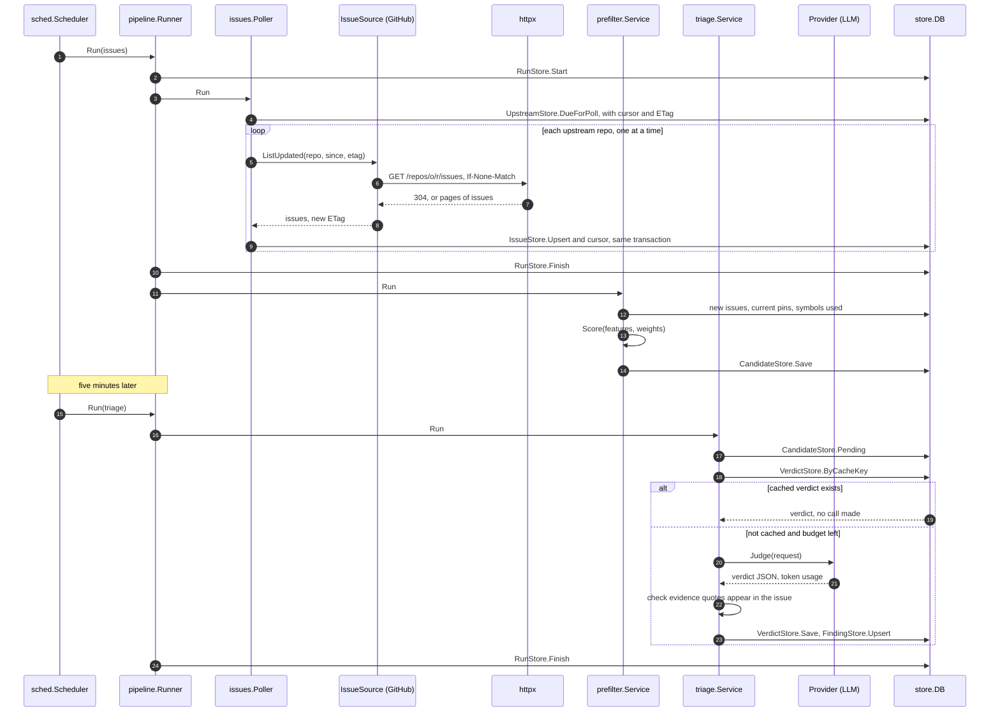

# Architecture

This document shows how upstreamwatch is put together: what sits outside the binary, the layers inside it, what each job does, and how two typical requests travel through the code. It follows [the plan](../mvp-plan/PLAN.md); where the design differs from the plan, the difference is listed in [decisions.md](decisions.md).

upstreamwatch ships as one Go binary, `upw`, with three ways in, a set of jobs in the middle, and one package that owns the database.

## System context

You reach `upw` over the tailnet or by SSH. Everything else is the binary calling out; nothing on the internet can call in. All outside calls are read-only except the digest (email, webhook or ntfy) and the LLM request. Each outside service is described in [external-sources.md](external-sources.md).

Two tokens keep the private side and the public side apart: one can read the target repos, the other has no repository access and only raises the GitHub rate limit for public upstreams.

The LLM key comes from the `UPW_LLM_API_KEY` environment variable or from the settings page in the web UI. The variable wins if both are set. `cmd/upw` hands each provider adapter a `KeySource` that applies that rule; `settings.Service` is the only code that encrypts and decrypts the stored key. See [data-access.md](data-access.md) for how the key is stored.

## Layers

There are three entry points: the CLI, the cron scheduler and the HTTP server. None of them contains logic. Each one turns its input into a call on an application service. Services hold the workflow, call pure domain functions for the decisions, and reach the outside world and the database only through interfaces.

The diagram is a component diagram (the C4 model calls this level "components"). The two sequence diagrams further down show individual requests.

Arrows point in the direction of the call. Nothing in layers 3 to 5 calls upward, and adapters never call each other or the store directly; a service always sits between them.

The email notifier is the one adapter that does not go through `httpx`. It speaks SMTP with the standard library. See [interfaces.md](interfaces.md).

## Packages

Every package under `internal/`, plus `cmd/upw`. The layer numbers are those of the diagram above. `config`, `httpx`, `llm` and `testutil` are not numbered boxes in it: `httpx` is drawn between layers 4 and 5, `llm` is a pure helper package used by `triage` and the two LLM adapters, and `config` and `testutil` are not drawn.

| Package | Layer | What it owns |
|---|---|---|
| `cmd/upw` | 1 Entry | The CLI commands; turns arguments into service calls. |
| `internal/sched` | 1 Entry | Cron ticks; hands job names to `pipeline.Runner`. |
| `internal/web` | 1 Entry | HTTP handlers and templates; no logic. |
| `internal/pipeline` | 2 Service | `Runner` and the `Job` interface: runs one job, records the run, raises `job_failure`. |
| `internal/ingest` | 2 Service (job) | Target repo registration: stores each configured target, syncs it through `GitSource` and records the fetch attempt in `repos`. The URL and host policy is applied by `internal/gitsrc`. |
| `internal/timeline` | 2 Service (job) | Manifest history into dependency events and intervals. |
| `internal/usage` | 2 Service (job) | The symbol-usage index. Adapters are the two packages below. |
| `internal/usage/golang` | 4 Adapter | `UsageIndexer` for Go source, using `go/parser`. |
| `internal/usage/python` | 4 Adapter | `UsageIndexer` for Python source, by import scan. |
| `internal/vuln` | 2 Service (job) | Advisory matching, exposure window and confidence. Adapters in `vuln/osv`, `vuln/kev`, `vuln/epss`. |
| `internal/upstream` | 2 Service (job) | Package to upstream repo resolution, first resolver wins. Resolvers are subpackages. |
| `internal/issues` | 2 Service (job) | `Poller`: upstream issues and comments with cursors. Adapter in `issues/github`. |
| `internal/prefilter` | 2 Service (job) | Feature extraction and weighted score for issue candidates. |
| `internal/triage` | 2 Service (job) | `Service` and the `Provider` interface: cache key, budget, evidence check, verdicts. May import `internal/llm`. |
| `internal/report` | 2 Service (job) | The digest: ranking, what changed, and the `Notifier` interface. |
| `internal/ops` | 2 Service (job) | `Backup`. |
| `internal/findings` | 2 Service | Ack, snooze, dismiss and auto-resolve. |
| `internal/settings` | 2 Service | The LLM key, write-only. The only code that encrypts and decrypts it, and the only user of `SettingsStore`. |
| `internal/eval` | 2 Service | Eval labels, runs and reports. It declares its own small interface for "judge this candidate", which `triage.Service` satisfies; `cmd/upw` wires them. It imports `model` only and never calls a provider. |
| `internal/query` | 2 Service | The read services behind the web pages and the read-only CLI commands: timeline, coverage, finding detail, eval report. Imports `model` and declares the store interfaces it needs. |
| `internal/model` | 3 Domain | Shared objects and their pure rules, plus `Scope` and `Stats`. See [domain-model.md](domain-model.md). |
| `internal/gitsrc` | 4 Adapter | `GitSource` over the `git` binary; the only `os/exec` user. Owns the URL and host policy for git remotes (https only, no userinfo, resolved addresses checked with `httpx.BlockedAddr`) and the clone size cap. |
| `internal/extract`, `internal/extract/unity` | 4 Adapter | `Extractor` implementations: `extract` (`go.mod`, Dockerfile, compose, and the other formats through the manifests library) and `unity` (the Unity project files). Both do no I/O. |
| `internal/llm` | Pure helper, beside 4 | Provider-neutral prompt builder, vocabulary constants, output schema and cost helpers. No I/O; imports `model` only. `triage` and the two adapters below may import it. |
| `internal/llm/anthropic` | 4 Adapter | `Provider` using the Anthropic SDK. May import `llm`, `httpx` and `model`. Built with a `KeySource`. |
| `internal/llm/openaicompat` | 4 Adapter | `Provider` for OpenAI-compatible chat endpoints (config value `openai_compat`). May import `llm`, `httpx` and `model`. Built with a `KeySource`. |
| `internal/notify/email`, `discord`, `slack`, `ntfy`, `stdout` | 4 Adapter | One `Notifier` each. |
| `internal/httpx` | between 4 and 5 | Shared HTTP client: ETags, rate limits, retries, URL policy. Also exports `BlockedAddr`, the address check `gitsrc` applies to git remotes. |
| `internal/store` | 5 Store | `store.DB`, the migrations, transactions; the only `database/sql` user. |
| `internal/config` | not drawn | Config loading, defaults and validation (a file with a second YAML document that has content is rejected; empty or null later documents are ignored); only `cmd/upw` imports it. Default listen address `127.0.0.1:8080`; the container config sets `0.0.0.0:8080`. |
| `internal/testutil` | not drawn | Test helpers such as the fixture git repo builder (`internal/testutil/gitrepo`); no production package imports it. |

Every interface is declared in the package that uses it, so `Provider` is in `internal/triage`, not in `internal/llm`, and eval's "judge this candidate" interface is in `internal/eval`.

After M0 these packages exist: `cmd/upw`, `internal/config`, `internal/model`, `internal/store`, `internal/httpx`, `internal/pipeline`, `internal/sched`, `internal/web`, `internal/query`, `internal/gitsrc`, `internal/vuln/osv`, `internal/upstream/depsdev` and `internal/issues/github`. The last three hold only `New` and `Check` (the doctor probe). M1 adds `internal/ingest`, `internal/timeline`, `internal/extract`, `internal/extract/unity` and `internal/testutil/gitrepo`, and `internal/gitsrc` gains the `GitSource` methods. `cmd/upw` registers the ingest and timeline jobs with the Runner, in that order, sharing one `gitsrc` client. The other rows above are planned for later milestones. `Runner` runs one job at a time: a second call waits for the first to end.

## What each job does

Each row is one job: the service that implements it, the pure decisions it makes, what it calls out through, and the tables it writes. Tables are described in [database.md](database.md) and the store interfaces in [data-access.md](data-access.md).

| Job | Service object | Decisions (pure) | Calls out through | Writes tables |
|---|---|---|---|---|
| ingest | `ingest.Service` | none (the URL and host policy is applied inside `GitSource`) | `GitSource` | repos |
| timeline | `timeline.Service` | diff manifest states into events; fold events into intervals | `GitSource`, `Extractor` | commits, manifests, packages, dep_events, dep_versions |
| usage | `usage.Service` | none | `GitSource`, `UsageIndexer` | symbol_usage |
| vulns | `vuln.Service` | version in range; exposure window; confidence label | `AdvisorySource`, `ExploitSignals` | advisories, advisory_affected, advisory_matches, findings |
| upstream | `upstream.Service` | resolver order, first hit wins | `UpstreamResolver` chain | upstream_repos, package_upstream |
| issues | `issues.Poller` | cursor and backfill bounds | `IssueSource` | upstream_issues, upstream_issue_comments, cursors on upstream_repos |
| prefilter | `prefilter.Service` | feature extraction and weighted score | nothing external | issue_candidates |
| triage | `triage.Service` | cache key; budget; evidence is a real quote | `Provider` | llm_verdicts, findings |
| digest | `report.Service` | ranking; what changed since last digest | `Notifier` (every enabled one) | findings, digests |
| backup | `ops.Backup` | retention | store only | backup file |

The timeline job bounds what a repository can make it hold or store. It reads file contents from `GitSource` 32 files at a time. A file that parses to more than 20,000 dependencies counts as a parse error, and a target run that would produce more than 500,000 new events fails. Before events are computed it drops every dependency whose package name or package URL contains a control character, whitespace, `://` or `@`, counting them in the `deps_dropped` stat, and passes every version and requirement through `model.Redact`. Parse errors are logged redacted.

## Entry points

### HTTP routes

| HTTP route | Handled by |
|---|---|
| `GET /` | findings list (read) |
| `GET /f/{id}` | finding detail (read) |
| `POST /f/{id}/ack\|snooze\|dismiss` | `findings.Service` |
| `POST /f/{id}/label` | `eval.Service` |
| `GET /repos` | repository list (read) |
| `GET /repos/{slug}` | timeline (read); optional query parameters `q` (substring of the package URL), `pkg` (exact package URL, the history of one package) and `on` (`YYYY-MM-DD`, only intervals in force at the end of that UTC day) |
| `GET /coverage` | coverage (read) |
| `GET /eval` | eval report (read) |
| `GET /settings`, `POST /settings` | `settings.Service` (LLM key, write-only; scheduled with the LLM milestone, M4) |
| `GET /health` | last runs, JSON |
| `GET /static/style.css` | the embedded stylesheet |

After M1 the server answers `GET /`, `GET /repos`, `GET /repos/{slug}`, `GET /health` and `GET /static/style.css`; `GET /` lists unresolved findings in state open or acked, highest score first. The pages read through `internal/query`: `web` declares the `TimelineReader` interface (`Repos` and `Timeline`) that `query.Service` satisfies. `GET /repos/{slug}` answers 404 for an unknown slug and 400 for an `on` value that is not a date. The other routes are planned for later milestones. Every response carries the security headers, and cross-origin requests that change state are refused by the standard library's cross-origin protection, trusting the origin of `http.base_url` when set. A host check answers 421 to a request whose `Host` header is not the listen address, a loopback name (`localhost`, `127.0.0.1`, `::1`, the only names answered when the listen host is unspecified, such as `0.0.0.0`) or the host of `http.base_url`; it stops a DNS-rebinding page from reaching the UI. A `http.base_url` with an empty hostname is rejected by config validation and by the server. On shutdown, requests still running after ten seconds have their connections closed.

The settings page never shows the stored key. It shows the last four characters only.

### CLI

| CLI | Handled by |
|---|---|
| `upw serve` | starts Scheduler and web.Server; stops on SIGINT or SIGTERM, web server first, then the scheduler, then the store |
| `upw run <job>`, `run all -once` | `pipeline.Runner`; `-repo <slug>` limits one job to one target and cannot be used with `all` |
| `upw timeline <slug> [package-url] [-on YYYY-MM-DD] [-json]` | `query.Service.Timeline`; prints the repo's dependency intervals as a table, or as a JSON array with `-json`; in the table a package URL, version or manifest path with a control character or invalid UTF-8 is printed in quoted form; `-on` keeps the intervals in force at the end of that UTC day; builds no Runner and starts nothing |
| `upw findings` | `internal/query` |
| `upw llm estimate\|rejudge` | `triage.Service` |
| `upw eval run\|report\|import` | `eval.Service` (`import` imports labels) |
| `upw export verdicts\|labels\|state` | store export; one kind per invocation, written to stdout. `upw eval export` is an alias of `upw export labels` |
| `upw doctor` | each outbound adapter's `Check` (the `Checker` interface in [interfaces.md](interfaces.md)); prints one line per check, does not open the database and exits 1 if any check fails. The probes are listed in [external-sources.md](external-sources.md) |

Every command takes `-config <path>` (default `upw.yaml`) and `-log-level` (debug, info, warn or error). `upw serve` and `upw run` load the config, open and migrate the database and build the Runner. After M1 the Runner has two jobs, ingest and timeline, so `run all -once` runs those two; a schedule's chain leaves out the jobs not registered yet, so the `ingest` schedule runs ingest then timeline until the usage and upstream jobs exist, and the other schedules' chains are empty until the milestones that add their jobs. The commands `findings`, `llm`, `eval` and `export` are planned for later milestones.

### Schedules

| Schedule | Config key and default | Jobs run in order |
|---|---|---|
| every 6 h | `ingest`: `5 */6 * * *` | ingest, timeline, usage, upstream |
| every 6 h, +5 min | `vulns`: `10 */6 * * *` | vulns |
| hourly | `issues`: `15 * * * *` | issues, prefilter |
| hourly, +5 min | `llm`: `20 * * * *` | triage |
| 08:00 daily | `digest`: `0 8 * * *` | digest |
| 03:30 daily | `backup`: `30 3 * * *` | backup |

Each schedule is a five-field cron expression (minute, hour, day of month, month, day of week) evaluated in the process's local time zone, so the compose file sets `TZ`. Seconds fields, descriptors such as `@daily` and a `TZ=` or `CRON_TZ=` prefix are rejected. Defaults are set in `internal/config` and shown in `deploy/upw.example.yaml`. A schedule runs its jobs one after another through the Runner; one job's failure is logged and the next job still runs. A tick is skipped, with a warning, while the previous run of the same schedule is still going. Once `Scheduler.Stop` is called no chain starts and a running chain starts no further job; Stop returns nil when no chain is running, and an error only if its context ends while one still is. `notify.heartbeat` (default `0 8 * * 1`, weekly) is a config key for the "all quiet" message; the scheduler does not run it yet.

## Two requests, followed end to end

### You acknowledge a finding in the browser

The handler never touches SQL and never decides whether a transition is legal. The rule lives on the domain object so the CLI and the digest get the same answer.

### The hourly tick finds a new upstream issue and judges it

A failed job is caught by the Runner, written to the runs table and raised as a job_failure finding, so it shows up in the next digest instead of failing quietly. The error text passes through `model.Redact` before it is stored in `runs.error`, in the finding's rank reason and in the log, so a credential an outside tool echoed does not reach `/health` or the findings page; `errors.Is` and `errors.As` still see the original error. A job that panics is recorded the same way, with an error starting `panic: `. A run whose context was cancelled or past its deadline when the job returned is recorded as failed even if the job returned no error; the error is the context's. There is one job_failure finding per job, with fingerprint `job_failure|<job>`; a repeat failure refreshes it, and the next successful run of that job resolves it.
