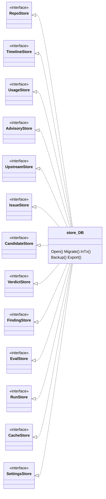

# Data access

This document describes how code reaches the database: the `store.DB` type, the thirteen store interfaces, which tables sit behind each one, and the rules for transactions and writers. Table and column details are in [database.md](database.md).

`store.DB` lives in `internal/store`. It is the only package that imports `database/sql`, holds the migrations, and opens transactions. Services never see SQL. Each service asks for the narrow slice it needs, so the prefilter cannot write findings by accident and a test can fake five methods instead of fifty.

## Store interfaces

One concrete type, thirteen small interfaces. The interfaces group tables that change together.

## Table to interface map

| Store interface | Tables behind it | Used by |
|---|---|---|
| `RepoStore` | repos | ingest, timeline, query |
| `TimelineStore` | commits, manifests, packages, dep_events, dep_versions | timeline (write); vulns, prefilter, triage, query (read) |
| `UsageStore` | symbol_usage | usage (write); prefilter, triage (read) |
| `AdvisoryStore` | advisories, advisory_affected, advisory_matches | vulns |
| `UpstreamStore` | upstream_repos, package_upstream | upstream (write); issues, prefilter, coverage (read) |
| `IssueStore` | upstream_issues, upstream_issue_comments | issues (write); prefilter, triage (read) |
| `CandidateStore` | issue_candidates | prefilter (write); triage, eval (read) |
| `VerdictStore` | llm_verdicts | triage, eval |
| `FindingStore` | findings, finding_state, digests | vulns, triage, findings.Service, digest |
| `EvalStore` | eval_labels | eval, findings.Service on dismiss |
| `RunStore` | runs | pipeline.Runner, health, coverage |
| `CacheStore` | http_cache, kv | httpx, feed cursors |
| `SettingsStore` | settings | `settings.Service` only (read and write); the table holds ciphertext, and only `settings.Service` encrypts or decrypts. `triage` does not use it |

The `schema_migrations` table is owned by `store.DB` itself and has no interface.

## Rules

- Writes that must land together, such as the issues page and its cursor, go through `store.DB.InTx`, which hands the service the same interfaces bound to a transaction.
- The scheduler is the single writer for pipeline tables. The web server writes only finding state, eval labels and settings. SQLite runs in WAL mode so page loads never wait on a job.
- Store methods take and return domain objects (see [domain-model.md](domain-model.md)), never rows or `sql.Null*` types.
- Migrations are numbered SQL files embedded in the binary and applied at startup. They are forward-only and additive until 1.0. The binary refuses to start on a database newer than itself.

## Settings and the LLM key

The settings page lets the operator paste the LLM key into the web UI. The key is stored in the `settings` table encrypted at rest. The encryption key is a file in the data directory with mode 600. The key is write-only in the UI: the page shows the last four characters and never the value.

`settings.Service` is the only code that encrypts and decrypts the key and the only user of `SettingsStore`; the store holds ciphertext only. `triage` does not use `SettingsStore` and never reads the key. Instead each provider adapter is constructed with a `KeySource` (see [interfaces.md](interfaces.md)) and calls it on every `Judge` and `Check`, so a newly saved key works without a restart. `cmd/upw` wires the `KeySource`: `UPW_LLM_API_KEY` if set, otherwise `settings.Service`. Until the LLM milestone (M4) the environment variable is the only route. Milestones are in [mvp-plan/PLAN.md](../mvp-plan/PLAN.md), section 10.
