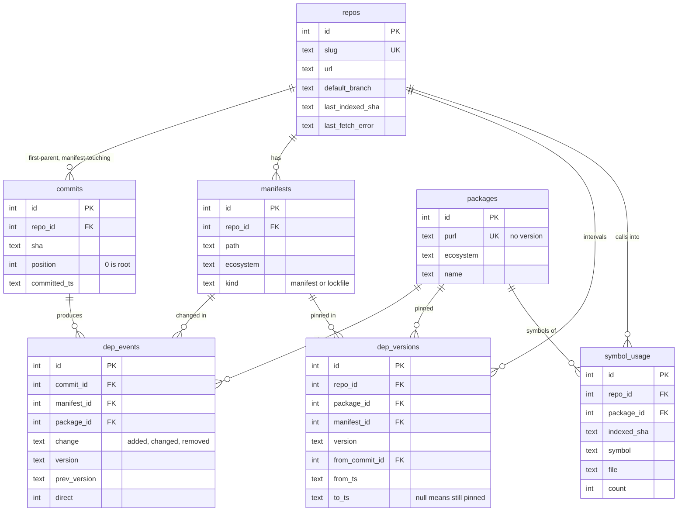
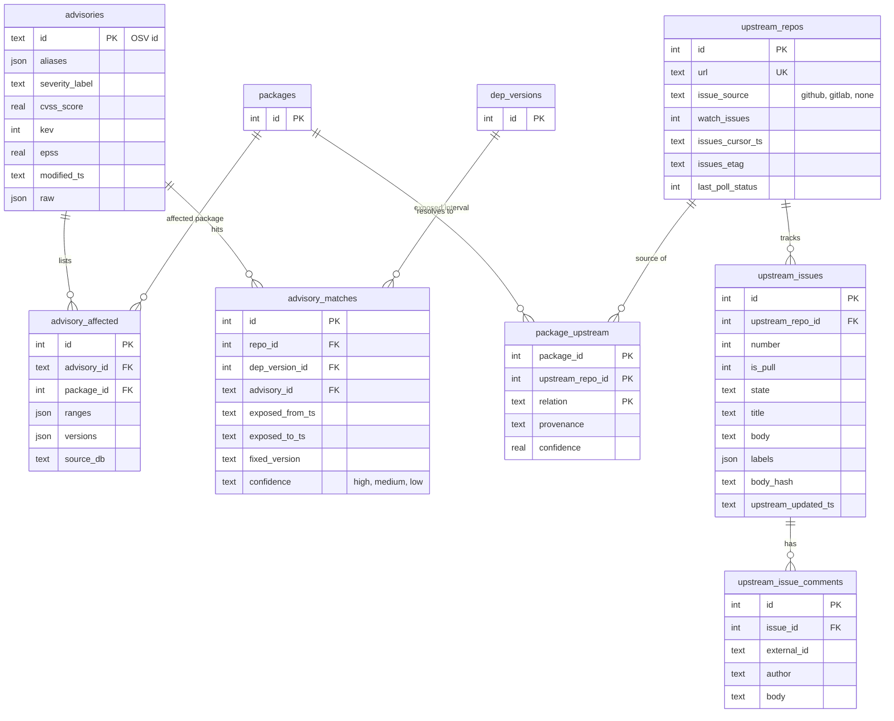
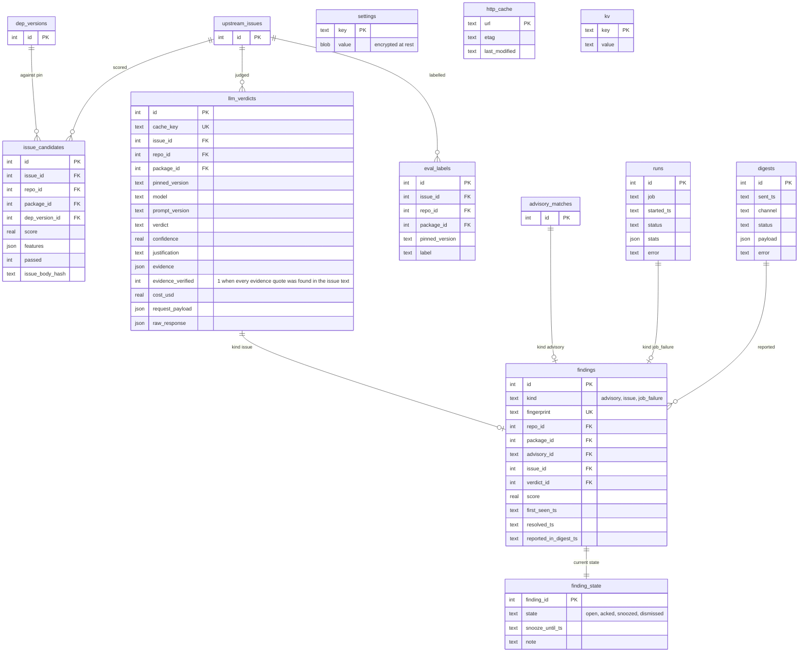

# Database

This document shows the SQLite schema: three entity-relationship diagrams, every table with its columns, and which tables can be rebuilt from outside sources. The schema comes from section 4 of [the plan](../mvp-plan/PLAN.md) plus four accepted additions: `llm_verdicts.request_payload`, `llm_verdicts.evidence_verified`, the `digests` table (with its `error` column) and the `settings` table. Which interface reads and writes each table is in [data-access.md](data-access.md).

The whole schema, every table below and the `dep_state` view, is created by one migration, `internal/store/migrations/0001_initial_schema.sql`. The reason is in [decisions.md](decisions.md).

Conventions: names are snake_case, primary keys are integers unless noted, and timestamp columns end in `_ts` and hold ISO-8601 UTC text (RFC 3339, second precision, `Z` suffix). Every table has `created_ts` and `updated_ts`, set by the store, except `kv`, `http_cache` and `settings`, which have only `updated_ts`, and `schema_migrations`, which has neither. The two timestamps are left out of the listings below. The ER diagrams show only keys and the columns that carry meaning.

## Entity-relationship diagrams

### Part A. Timeline: what was pinned, and when

`dep_events` is the source of truth. `dep_versions` is rebuilt from it and is what every other part joins to.

### Part B. Advisories and upstream issues

`packages` is the join between the two worlds: an advisory names a package, and a package resolves to the upstream repo whose issues we poll.

### Part C. Triage, findings, settings and operations

`llm_verdicts`, `finding_state` and `eval_labels` are the three tables that cannot be rebuilt from outside sources, which is why the backup and export commands exist.

## Tables and columns

### Targets

**repos**

| Column | Notes |
|---|---|
| id | |
| slug | unique; from config, for example `my-server` |
| url | |
| default_branch | |
| clone_path | |
| last_indexed_sha | |
| last_fetch_ts | |
| last_fetch_error | |

**commits** holds only first-parent commits that touched manifests. Unique on (repo_id, sha).

| Column | Notes |
|---|---|
| id | |
| repo_id | |
| sha | |
| position | 0 is the root, increasing toward HEAD |
| committed_ts | committer date of the first-parent commit |
| author_name | |
| author_email | |
| subject | |

**manifests**. Unique on (repo_id, path).

| Column | Notes |
|---|---|
| id | |
| repo_id | |
| path | |
| ecosystem | |
| kind | `manifest` or `lockfile` |

### Packages

**packages**

| Column | Notes |
|---|---|
| id | |
| purl | unique; version-less, for example `pkg:golang/github.com/gin-gonic/gin` |
| ecosystem | |
| name | |

### Timeline

**dep_events** is the core product table. Unique on (commit_id, manifest_id, package_id).

| Column | Notes |
|---|---|
| id | |
| repo_id | |
| commit_id | |
| manifest_id | |
| package_id | |
| change | `added`, `changed` or `removed` |
| version | resolved version when a lockfile or go.mod gives one; otherwise the requirement |
| prev_version | |
| requirement | raw constraint as written |
| direct | 1 direct, 0 transitive, NULL unknown |
| scope | `runtime`, `development`, `build` and so on |

**dep_versions** holds materialised intervals, rebuilt from `dep_events` per repo. A (repo, package) pair may have several open intervals when two manifests pin different versions.

| Column | Notes |
|---|---|
| id | |
| repo_id | |
| package_id | |
| manifest_id | |
| version | |
| direct | |
| from_commit_id | |
| from_ts | |
| to_commit_id | NULL means still present at HEAD |
| to_ts | NULL means still present at HEAD |

**dep_state** is a view: `dep_versions` where `to_ts IS NULL`.

### Upstream mapping

**upstream_repos**

| Column | Notes |
|---|---|
| id | |
| host | for example `github.com` |
| owner | |
| name | |
| url | unique |
| issue_source | `github`, `gitlab` or `none` |
| watch_issues | default 1; 0 for firehoses such as `golang/go` |
| issues_cursor_ts | |
| comments_cursor_ts | |
| issues_etag | |
| comments_etag | |
| last_poll_ts | |
| last_poll_status | |
| backfilled_to_ts | |

**package_upstream**. Primary key (package_id, upstream_repo_id, relation).

| Column | Notes |
|---|---|
| package_id | |
| upstream_repo_id | |
| relation | `source_repo` or `issue_tracker` |
| provenance | `module_path`, `go_get_meta`, `depsdev`, `ecosystems`, `curated` or `manual` |
| confidence | |
| resolved_ts | |

### Advisories

**advisories**

| Column | Notes |
|---|---|
| id | text primary key; the OSV id, for example `GO-2026-4599` or `GHSA-...` |
| aliases | JSON array |
| summary | |
| details | |
| severity_label | |
| cvss_score | |
| cvss_vector | |
| published_ts | |
| modified_ts | |
| withdrawn_ts | |
| kev | default 0 |
| kev_added_ts | |
| epss | |
| epss_percentile | |
| epss_ts | |
| raw | JSON; the full OSV record |

**advisory_affected**

| Column | Notes |
|---|---|
| id | |
| advisory_id | |
| package_id | |
| ranges | JSON; OSV `ranges[]` as is |
| versions | JSON; explicit `versions[]` list |
| ecosystem_specific | JSON; for Go, affected symbols live here |
| source_db | `GO`, `PYSEC`, `GHSA`, `CVE` and so on; the prefix of the advisory id |

**advisory_matches** has one row per (repo, package interval, advisory). Unique on (dep_version_id, advisory_id).

| Column | Notes |
|---|---|
| id | |
| repo_id | |
| dep_version_id | |
| advisory_id | |
| exposed_from_ts | |
| exposed_to_ts | NULL means still exposed |
| fixed_version | first fixed version at or above the pinned one, if known |
| confidence | `high`, `medium` or `low` |
| confidence_reason | |

### Upstream issues

In the two tables below, `upstream_created_ts` and `upstream_updated_ts` are the times reported by the upstream tracker. They are named apart from the store-set `created_ts` and `updated_ts` that every table has. PLAN.md section 4 calls them `created_ts` and `updated_ts`.

**upstream_issues**. Unique on (upstream_repo_id, number).

| Column | Notes |
|---|---|
| id | |
| upstream_repo_id | |
| number | |
| external_id | |
| is_pull | |
| state | |
| title | |
| body | |
| labels | JSON |
| author | |
| author_assoc | |
| upstream_created_ts | when it was created upstream |
| upstream_updated_ts | when it last changed upstream; drives the polling cursor |
| closed_ts | |
| comments_count | |
| body_hash | sha256 of title, body and labels; part of the LLM cache key |
| html_url | |

**upstream_issue_comments**. Unique on (issue_id, external_id).

| Column | Notes |
|---|---|
| id | |
| issue_id | |
| external_id | |
| author | |
| body | |
| upstream_created_ts | when it was created upstream |
| upstream_updated_ts | when it last changed upstream; drives the polling cursor |

### Target usage index

**symbol_usage** is the prefilter's input.

| Column | Notes |
|---|---|
| id | |
| repo_id | |
| package_id | |
| indexed_sha | |
| symbol | for example `gin.Context.BindJSON` or `yaml.safe_load` |
| file | |
| line | |
| count | |

### Prefilter and LLM

**issue_candidates**. Unique on (issue_id, repo_id, package_id, issue_body_hash).

| Column | Notes |
|---|---|
| id | |
| issue_id | |
| repo_id | |
| package_id | |
| dep_version_id | |
| score | |
| features | JSON; for example `{label_bug:1, version_in_range:["1.9.0"], symbols:["Context.BindJSON"], kw:["panic"]}` |
| passed | |
| scored_ts | |
| issue_body_hash | |

**llm_verdicts**

| Column | Notes |
|---|---|
| id | |
| cache_key | unique; sha256 of provider, model, prompt version, issue id, body hash, package, version, usage hash and snippet mode. The stored key includes provider and model. Scheduled runs look for an existing verdict matching everything except the model; only `upw llm rejudge` and `upw eval run` match the full key. |
| issue_id | |
| repo_id | |
| package_id | |
| pinned_version | |
| provider | |
| model | |
| prompt_version | |
| snippet_mode | |
| verdict | `affects`, `does_not_affect` or `cannot_tell` |
| confidence | 0 to 1, as returned |
| justification | controlled vocabulary |
| reasoning | |
| evidence | JSON; quotes from the issue the model relied on |
| evidence_verified | integer; 1 when every evidence quote was found in the issue text, otherwise 0 |
| fixed_in | |
| recommended_action | |
| input_tokens | |
| output_tokens | |
| cost_usd | |
| latency_ms | |
| request_payload | JSON; exactly what was sent to the model, so the finding page can show it |
| raw_response | JSON |

### Findings

**findings** is what the user sees.

| Column | Notes |
|---|---|
| id | |
| kind | `advisory`, `issue` or `job_failure` |
| repo_id | |
| package_id | |
| dep_version_id | |
| advisory_id | one of advisory_id and issue_id is set |
| issue_id | |
| verdict_id | |
| fingerprint | unique; kind, repo, package, and the advisory or issue (`kind\|repo\|package\|advisory_or_issue` in the plan). A `job_failure` finding has none of those, so its fingerprint is `job_failure\|<job>`: one finding per job |
| score | |
| rank_reason | |
| first_seen_ts | |
| last_changed_ts | |
| resolved_ts | set when the pin leaves the affected range or the issue closes as not a bug; for a `job_failure` finding, when the next run of the job succeeds |
| reported_in_digest_ts | |

**finding_state**

| Column | Notes |
|---|---|
| finding_id | primary key |
| state | `open`, `acked`, `snoozed` or `dismissed` |
| snooze_until_ts | |
| note | |
| changed_ts | |
| changed_by | |

**digests** records each send, so "send only if something changed since the last digest" has something to compare against and a failed send can be retried.

| Column | Notes |
|---|---|
| id | |
| sent_ts | |
| channel | the notifier that sent it; each enabled channel gets its own row |
| status | |
| payload | JSON |
| error | text; the failure message when the send failed, otherwise empty |

### Eval

**eval_labels**. Unique on (issue_id, repo_id, package_id, pinned_version).

| Column | Notes |
|---|---|
| id | |
| issue_id | |
| repo_id | |
| package_id | |
| pinned_version | |
| label | `affects`, `does_not_affect` or `cannot_tell` |
| note | |
| labelled_by | |
| labelled_ts | |

### Settings

**settings** holds values the operator sets in the web UI. Today that is the LLM key. The value is encrypted at rest with a key file in the data directory (mode 600), and the UI never shows it back.

| Column | Notes |
|---|---|
| key | text primary key; for example `llm_api_key` |
| value | BLOB, not null; encrypted |

### Ops

| Table | Columns |
|---|---|
| runs | id, job, started_ts, finished_ts, status, stats (JSON), error |
| http_cache | url (primary key), etag, last_modified, fetched_ts, status; the validators of conditional requests, one row per exact URL |
| kv | key (primary key), value; cursors for KEV, EPSS and the OSV `modified_id` files |
| schema_migrations | version (primary key), name, checksum, applied_ts; tracks applied migrations; owned by `store.DB` |

### Constraints the migration adds

- `runs.status` is one of `running`, `succeeded`, `failed`. `findings.kind` is one of `advisory`, `issue`, `job_failure`. `finding_state.state` is one of `open`, `acked`, `snoozed`, `dismissed`. All three are `CHECK` constraints.
- `runs.stats` is always a JSON object (`{}` when empty) and `runs.error` is the empty string when there is no failure; both are `NOT NULL`. `findings.score`, `rank_reason`, `first_seen_ts` and `last_changed_ts` are `NOT NULL`.
- A new `finding_state` row leaves `changed_ts` and `changed_by` NULL.
- Foreign keys are on. Deleting a `dep_versions` row, which a reindex does, deletes its `advisory_matches` and `issue_candidates` rows (`ON DELETE CASCADE`) and sets `findings.dep_version_id` to NULL (`ON DELETE SET NULL`). Every other foreign key is `NO ACTION`, so a parent row cannot be deleted while children point at it, and a finding of kind `advisory` or `issue` cannot be written until the rows it names exist.

## Reconstructible or not

| Table | Reconstructible? | How |
|---|---|---|
| repos, commits, manifests, packages, dep_events, dep_versions | Yes | re-clone, re-index |
| advisories, advisory_affected, advisory_matches | Yes | re-query OSV, KEV, EPSS (EPSS history is lost; current only) |
| upstream_repos, package_upstream | Yes, apart from `manual` overrides | re-resolve; keep manual overrides in config, not only in the database |
| upstream_issues, upstream_issue_comments | Mostly | re-poll; edited or deleted upstream content is gone, and backfill depth is bounded |
| symbol_usage, issue_candidates | Yes | recompute |
| **llm_verdicts** | **No** (costs money and the model may have changed) | nightly `VACUUM INTO` backup; `upw export verdicts > verdicts.json` (one kind per invocation, written to stdout) |
| **finding_state** (ack, snooze, dismiss) | **No** | same, plus `upw export state` |
| **eval_labels** | **No** (human time) | same, plus `upw export labels > labels.json` (`upw eval export` is an alias) kept outside the database |
| settings | No | re-enter the key in the web UI, or set `UPW_LLM_API_KEY`; the key file in the data directory must be backed up with it |
| digests | Not needed | only the last send matters |
| runs, http_cache, kv | Don't care | |
