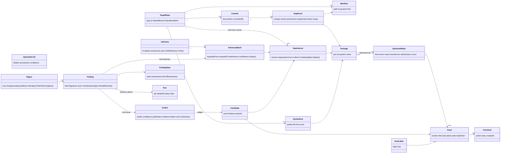

# Domain model

This document lists the objects the code passes around and how they relate. They live in `internal/model` and carry the rules that are true regardless of where the data came from. Without that shared package, feature packages would import each other for types and Go would reject the cycle.

The methods shown on the objects are the pure decisions from the layers in [architecture.md](architecture.md). The tables that store these objects are in [database.md](database.md).

The spine is `TargetRepo` to `DepInterval`. Both halves of the product hang off an interval: an advisory matches it, and an upstream issue becomes a candidate against it.

## Where the rules live

- `DepInterval.Contains(date)` and `IsOpen()` answer "what was pinned on date X" and "is it still pinned".
- Evaluating version ranges, the fixed version, the confidence label and the exposure window are unexported functions in `internal/vuln`, not methods on `Advisory`. The job table in [architecture.md](architecture.md) places these decisions there.
- `Verdict.CacheKey()` builds the key that makes sure one issue is judged once per dependency version.
- `RankAdvisory(AdvisoryRankInput)` scores an advisory finding, `Finding.Transition(StateChange)` is the state machine, `FindingState.Effective(now)` says what state the operator sees, and `ShouldResolve()` (auto-resolve) is still planned. The web handlers, the CLI and the digest all call these, so they agree.

## Built so far

After M0, `internal/model` holds `Finding` and `FindingState` (with the `FindingKind` and `FindingStateValue` constants), `Run` (with `RunStatus`), `HTTPValidator`, `Secret`, `Scope`, `Stats` and `ErrNotFound`. M1 adds the timeline types in `timeline.go` (listed under Other types) and `Redact`. M2 adds the advisory types (`advisory.go`), the digest types (`digest.go`, `digest_text.go`), `FindingDetail` (`finding_detail.go`), `RankAdvisory` (`rank.go`) and `Finding.Transition` (`state.go`), listed under Other types. The M1 types are plain data apart from `DepInterval.IsOpen` and `Contains`; `Finding` has no `ShouldResolve` yet, and the rest of the diagram above (`Verdict` and the issue side) is planned for the milestones that need it. The timeline's own decisions, diffing manifests into events and folding events into intervals, are unexported functions in `internal/timeline`. A `Finding` carries the ID fields of its kind; the ones that do not apply are zero, and a `job_failure` finding has none of them.

## Scope and Stats

Two small types in `internal/model` are used by the `Job` interface in [interfaces.md](interfaces.md), not by the class diagram.

| Type | Meaning |
|---|---|
| `Scope` | What a job run covers: all repos, or one repo slug (`RepoSlug`; empty means all, and `All()` says so). `Rebuild` asks a job that builds state from history, the timeline, to discard what it stored for the repos in scope and start from the root; other jobs ignore it. |
| `Stats` | What a job run reports back: named counters (`map[string]int64`); the `runs` table stores it as a JSON object in `stats`. |

## Other types

| Type | Meaning |
|---|---|
| `Secret` | A credential read from the environment. It prints, logs and marshals as its last four characters (`****` when eight or fewer), so it cannot leak through `fmt`, `slog` or JSON; `Reveal()` returns the value and is called only where the credential is sent. The config loader and `KeySource` use it. |
| `HTTPValidator` | The `ETag` and `Last-Modified` a server sent with its last full response to one URL, with the fetch time and status. The `http_cache` table stores one per exact URL, and `httpx` reads it to make a request conditional. |
| `ErrNotFound` | The error the store wraps when a looked-up record does not exist; callers test it with `errors.Is`. |
| `Redact` | A function, not a type: `Redact(s string) string` replaces credentials in error text with `[REDACTED]` (URL userinfo, GitHub tokens, Anthropic and OpenAI style keys, authorization header values, `x-access-token` values). Error text from outside tools passes through it before it is stored, logged or shown; `pipeline.Runner` and `ingest` use it. |
| `TargetRepo` | One repository whose history is mined: the configured fields (slug, URL, branch) and the stored ones (ID, default branch, clone path, last indexed commit, timeline settings fingerprint, last fetch time and error). `Token` and `AllowPrivateHost` are not stored. |
| `SyncResult`, `FetchResult` | What a clone or fetch produced (branch, head, clone path, whether it cloned), and one fetch attempt as recorded in `repos` (time, and branch and clone path only on success, or the error text). |
| `Commit`, `BlobRef`, `Blob` | A first-parent commit that touched manifest paths, with the matching paths it changed; a file at a commit; its content, with `Missing` for a deleted path and `TooLarge` for a file over the size cap. |
| `Package`, `Dependency`, `ParsedManifest`, `ManifestKind` | A package without a version (`PURL`, ecosystem, name); one package as one file declares it (version, requirement, `Directness`, scope); one parsed file (ecosystem, kind, dependencies); `manifest` or `lockfile`. `ErrUnsupportedFile` is what an extractor returns, wrapped, for a path it does not handle. |
| `Directness` | `DirectUnknown`, `DirectYes` or `DirectNo`; stored as NULL, 1 or 0. |
| `DepEvent`, `Change` | One change to one package in one manifest at one commit (`added`, `changed` or `removed`). |
| `DepInterval` | A span of commits during which one manifest pinned one package at one version; open while `ToSHA` is empty. |
| `TimelineUpdate`, `ManifestInfo` | Everything one timeline run writes for one repo, applied by the store in one transaction; the ecosystem and kind of one manifest path. |
| `PackageVersion`, `AdvisoryRef` | One version-less package URL at one resolved version, the unit an advisory database is queried with; and an advisory id with the time its record last changed. |
| `Advisory`, `AffectedPackage`, `AffectedRange`, `RangeEvent`, `RangeType` | One OSV record with its exploit signals (`KEV`, `KEVAddedAt`, and `HasEPSS`, `EPSS`, `EPSSPercentile`, `EPSSAt`); one `affected[]` entry (a version-less `Package` already mapped from the database's ecosystem and name, ranges, explicit versions, `EcosystemSpecific`, `SourceDB`); one range (`SEMVER`, `ECOSYSTEM` or `GIT`) and its events, each event setting exactly one of introduced, fixed, last affected or limit. `Raw` holds the record as fetched. `Advisory` has two methods, `IsWithdrawn()` and `CVEs()` (the advisory's id if it is a CVE id, then its CVE aliases); `SourceDB(id)` is a function that returns the prefix of an advisory id. |
| `SeverityLabel`, `Confidence` | The stored values of `advisories.severity_label` (`critical`, `high`, `medium`, `low`, and empty for unknown) and `advisory_matches.confidence` (`high`, `medium`, `low`). A stored value is never renamed. |
| `AdvisoryMatch`, `RepoInterval` | One advisory affecting one dependency interval, with its exposure window (`ExposedTo` zero while still exposed; `IsOpen()`), fixed version and confidence with its reason; and one stored interval with its repo and package IDs, as the matcher reads it. |
| `Signal`, `SignalKind` | One exploit signal for one CVE id from one feed (`kev` or `epss`). |
| `OSVEcosystem`, `PURLType` | Functions: the OSV ecosystem name for a package URL (`Go` for `pkg:golang/...`) and whether OSV has one (not for `docker`, `upm` or `generic`), and the type of a package URL. `OSVEcosystem` is the one table of package URL types OSV covers. |
| `AdvisoryRankInput`, `RankAdvisory`, `JobFailureScore` | The advisory score and its one-line reason. The score is a severity base (critical 90, high 70, medium 40, low 20, unknown 30), plus 30 for KEV, plus the EPSS percentile times 20 rounded, plus 10 for a direct dependency, plus 20 when still exposed, minus 10 for medium and 25 for low confidence; every part is an integer, so daily EPSS drift rarely changes the score. A `job_failure` finding scores `JobFailureScore` (50). |
| `StateChange`, `ErrInvalidTransition`, `MaxNoteRunes` | One operator action on a finding. `Finding.Transition` returns the new `FindingState` or an error wrapping `ErrInvalidTransition`: a resolved finding, an unknown state, a snooze with no end in the future, or a note that is not valid UTF-8, is longer than `MaxNoteRunes` (2000) or holds a control character other than newline and tab. Any state may move to any other, itself included. `FindingState.Effective(now)` counts a snooze that has ended as open. |
| `Digest`, `DigestItem` | The daily summary, built once and sent unchanged to every enabled notifier; stored as JSON in `digests.payload`. It holds new and changed items (each with a tag, headline, detail lines and URL, rendered by the digest job), counts of items left out past the per-section cap, the number of candidates waiting for LLM budget, the last run of each job, counts of open, acked and snoozed findings, and the findings page URL. `Heartbeat` marks the "all quiet" message. `PlainText()` lays it out for email, ntfy and stdout and `Subject()` gives the one-line summary. |
| `DigestRecord`, `DigestStatus` | One row of `digests`: a digest sent or tried on one channel, with status `sent`, `failed` or `retried`, the payload and the redacted error. |
| `FindingFilter` | Selects findings for the findings list: repo, kind, whether to include snoozed and dismissed findings, and the time used to decide whether a snooze has ended. |
| `FindingDetail`, `Exposure` | One finding with what is needed to show it: repo slug, package, the interval it links to, and for an advisory finding the advisory and every match of it against an interval of the finding's repo and package. |
