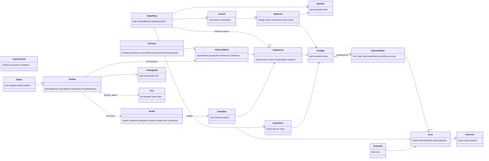

# Domain model

This document lists the objects the code passes around and how they relate. They live in `internal/model` and carry the rules that are true regardless of where the data came from. Without that shared package, feature packages would import each other for types and Go would reject the cycle.

The methods shown on the objects are the pure decisions from the layers in [architecture.md](architecture.md). The tables that store these objects are in [database.md](database.md).

The spine is `TargetRepo` to `DepInterval`. Both halves of the product hang off an interval: an advisory matches it, and an upstream issue becomes a candidate against it.

## Where the rules live

- `DepInterval.Contains(date)` and `IsOpen()` answer "what was pinned on date X" and "is it still pinned".
- `Advisory.Affects(version)` and `FixedVersion(pinned)` evaluate version ranges.
- `Verdict.CacheKey()` builds the key that makes sure one issue is judged once per dependency version.
- `Finding.Rank()`, `Transition(to)` and `ShouldResolve()` hold ranking, the state machine and auto-resolve. The web handlers, the CLI and the digest all call these, so they agree.

## Built so far

After M0, `internal/model` holds `Finding` and `FindingState` (with the `FindingKind` and `FindingStateValue` constants), `Run` (with `RunStatus`), `HTTPValidator`, `Secret`, `Scope`, `Stats` and `ErrNotFound`. They are plain data: `Finding` has no `Rank`, `Transition` or `ShouldResolve` yet, and the rest of the diagram above is planned for the milestones that need it. A `Finding` carries the ID fields of its kind; the ones that do not apply are zero, and a `job_failure` finding has none of them.

## Scope and Stats

Two small types in `internal/model` are used by the `Job` interface in [interfaces.md](interfaces.md), not by the class diagram.

| Type | Meaning |
|---|---|
| `Scope` | What a job run covers: all repos, or one repo slug (`RepoSlug`; empty means all, and `All()` says so). |
| `Stats` | What a job run reports back: named counters (`map[string]int64`); the `runs` table stores it as a JSON object in `stats`. |

## Other types

| Type | Meaning |
|---|---|
| `Secret` | A credential read from the environment. It prints, logs and marshals as its last four characters (`****` when eight or fewer), so it cannot leak through `fmt`, `slog` or JSON; `Reveal()` returns the value and is called only where the credential is sent. The config loader and `KeySource` use it. |
| `HTTPValidator` | The `ETag` and `Last-Modified` a server sent with its last full response to one URL, with the fetch time and status. The `http_cache` table stores one per exact URL, and `httpx` reads it to make a request conditional. |
| `ErrNotFound` | The error the store wraps when a looked-up record does not exist; callers test it with `errors.Is`. |
