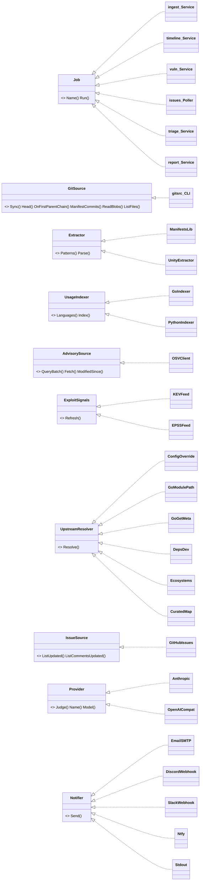

# Outbound interfaces

This document lists the interfaces that services use to reach the outside world, their Go signatures, and the adapters that implement each one. For the layers these sit in, see [architecture.md](architecture.md). For the services behind each outside source, see [external-sources.md](external-sources.md).

Each interface is declared in the package that uses it, which is the Go convention, and implemented in an adapter package. Tests give a service a hand-written fake in place of the real adapter, so no unit test needs the network, a git remote or an API key.

## Interface and implementation diagram



Ten interfaces to the outside, plus `Checker`, which every outbound adapter also implements (not drawn). GitLab and Gitea issue adapters, a release watcher and a Plane notifier are later additions that plug into `IssueSource` and `Notifier` without touching a service.

## Signatures

Types named here are the domain objects described in [domain-model.md](domain-model.md).

```go
// Signatures as designed, except GitSource and Extractor, which are as built in M1
// (ListFiles is still as designed). Types named here are the domain objects in domain-model.md.

type Job interface {
    Name() string
    Run(ctx context.Context, scope Scope) (Stats, error)        // scope: all repos or one slug
}

type GitSource interface {
    Sync(ctx context.Context, repo TargetRepo) (SyncResult, error)                  // clone or fetch, bare
    Head(ctx context.Context, repo TargetRepo) (string, error)                      // what the indexed branch points at in the clone
    OnFirstParentChain(ctx context.Context, repo TargetRepo, commit, head string) (bool, error) // is commit on the first-parent chain ending at head (head counts)
    ManifestCommits(ctx context.Context, repo TargetRepo, from, to string, patterns []string) ([]Commit, error)
    ReadBlobs(ctx context.Context, repo TargetRepo, refs []BlobRef) ([]Blob, error) // one cat-file --batch
    ListFiles(ctx context.Context, repo TargetRepo, sha string, globs []string) ([]string, error) // not built yet
}

type Extractor interface {
    Patterns() []string                                          // manifest path globs it understands, in git pathspec syntax
    Parse(path string, content []byte) (ParsedManifest, error)   // ErrUnsupportedFile (wrapped) for a path it does not handle
}

type UsageIndexer interface {
    Languages() []string
    Index(ctx context.Context, files []Blob, pkgs []Package) ([]SymbolUse, error)
}

type AdvisorySource interface {
    QueryBatch(ctx context.Context, pvs []PackageVersion) ([]AdvisoryRef, error)
    Fetch(ctx context.Context, id string) (Advisory, error)
    ModifiedSince(ctx context.Context, ecosystem string, t time.Time) ([]AdvisoryRef, error)
}

type ExploitSignals interface {                                   // KEV, EPSS
    Refresh(ctx context.Context) ([]Signal, error)                // keyed by CVE alias
}

type UpstreamResolver interface {
    Resolve(ctx context.Context, p Package, version string) (link UpstreamLink, found bool, err error)
}

type IssueSource interface {
    ListUpdated(ctx context.Context, repo UpstreamRepo, since time.Time, etag string) (IssuePage, error)
    ListCommentsUpdated(ctx context.Context, repo UpstreamRepo, since time.Time, etag string) (CommentPage, error)
}

type Provider interface {
    Judge(ctx context.Context, req JudgeRequest) (JudgeResponse, Usage, error)
    Name() string
    Model() string
}

type Notifier interface {
    Send(ctx context.Context, d Digest) error
}

type Checker interface {
    Check(ctx context.Context) error                          // cheap reachability and auth probe; never mutates
}

// KeySource returns the current LLM key. Each provider adapter is built with one
// and calls it on every Judge and Check. cmd/upw wires it.
type KeySource func(ctx context.Context) (model.Secret, error)
```

`Judge` returns `(JudgeResponse, Usage, error)`. Besides the parsed verdict fields, `JudgeResponse` carries two extra fields, `RequestPayload` and `RawResponse`: the exact bytes sent to the provider and received from it. Triage stores them as `llm_verdicts.request_payload` and `raw_response`.

`Checker` is implemented by every outbound adapter (git, HTTP sources, LLM providers, notifiers) and is what `upw doctor` calls. It does not need its own box in the class diagram. It is declared in `cmd/upw`, which is its consumer, and `upw doctor` reaches adapters through it:

```go
type Checker interface {
	Check(ctx context.Context) error
}
```

Of the signatures above, `Job` is declared in `internal/pipeline` and takes `model.Scope` and returns `model.Stats`: `Run(ctx context.Context, scope model.Scope) (model.Stats, error)`. The `osv`, `depsdev` and `github` adapters hold only `New` and `Check`; their interface methods arrive with the milestones that use them (see Implementations).

`GitSource` is declared twice, each time with only the methods its consumer calls: `ingest.GitSource` has `Sync`, and `timeline.GitSource` has `Head`, `OnFirstParentChain`, `ManifestCommits` and `ReadBlobs`. `gitsrc.CLI` implements all five; `ListFiles` is not built yet. `Sync` returns a `model.SyncResult` (branch, head, clone path, whether it cloned). `ManifestCommits` returns the first-parent commits after `from` (empty means from the root) up to `to` that changed a path matching one of the patterns, oldest first, each with the matching paths it changed, deletions included. `OnFirstParentChain` reports whether `commit` is on the first-parent chain ending at `head`, `head` itself counting; a `commit` that is not in the clone (as after a force-push whose old history was pruned) is not on the chain, while a `head` that is not in the clone is an error, and so is a chain listing past the 64 MiB log limit before a match. Being an ancestor is not enough, because a commit reachable only through a merge's second parent was never on the branch as the new head sees it. `gitsrc.CLI` still has `IsAncestor`, which nothing in the pipeline calls. `Extractor` is declared in `internal/timeline`; its `Parse` returns a `model.ParsedManifest` (ecosystem, kind and dependencies).

The LLM key has one seam. `cmd/upw` builds the `KeySource`: the `UPW_LLM_API_KEY` variable if set, otherwise `settings.Service`, which is the only code that encrypts and decrypts the stored key. Because the adapter calls it on every `Judge` and `Check`, a key saved in the web UI works without a restart. `triage` does not use `SettingsStore` and never sees the key; only `settings.Service` does, and the store holds ciphertext only.

`eval` declares its own small interface for "judge this candidate", which `triage.Service` satisfies; `cmd/upw` wires them. So `eval` imports `model` only and does not import `triage`.

## Implementations

| Interface | Implementations | Notes |
|---|---|---|
| `Job` | `ingest.Service` and `timeline.Service` (registered with the Runner by `cmd/upw`), `vuln.Service`, `issues.Poller`, `triage.Service`, `report.Service` | `usage.Service`, `upstream.Service`, `prefilter.Service` and `ops.Backup` are also jobs; the diagram shows the main ones. See the job table in [architecture.md](architecture.md). |
| `GitSource` | `gitsrc.CLI` (shells out to the `git` binary) | Bare clones only. `gitsrc.CLI` has `Sync`, `Head`, `OnFirstParentChain`, `IsAncestor` (unused by the pipeline), `ManifestCommits`, `ReadBlobs` and `Check` (`git --version`); `ListFiles` comes with the usage index. `Sync` applies the URL and host policy, see [external-sources.md](external-sources.md). |
| `Extractor` | `extract.Extractor` (`internal/extract`), `unity.Extractor` (`internal/extract/unity`) | `extract.Extractor` reads `go.mod` (with `golang.org/x/mod/modfile`), Dockerfiles and compose files (its own parsers) and the other formats through the `manifests` library. The Unity extractor reads `Packages/manifest.json`, `Packages/packages-lock.json` and `ProjectSettings/ProjectVersion.txt`. The timeline offers the Unity extractor first, for targets that enable it, then the others in order; the first that does not report `ErrUnsupportedFile` handles the file. |
| `UsageIndexer` | Go indexer (`go/parser`), Python indexer (import scan) | No type-checking in the MVP. |
| `AdvisorySource` | OSV client | API for per-version queries, bucket for daily deltas. `osv.Client` (`internal/vuln/osv`) has only `New` and `Check` so far. |
| `ExploitSignals` | CISA KEV feed, EPSS feed | Both keyed by CVE alias. |
| `UpstreamResolver` | config override, Go module path, go-get meta, deps.dev, ecosyste.ms, curated map | A chain; the first hit wins. `depsdev.Resolver` (`internal/upstream/depsdev`) has only `New` and `Check` so far. |
| `IssueSource` | GitHub issues | GitLab and Gitea come later. `github.Source` (`internal/issues/github`) has only `New` and `Check` so far. |
| `Provider` | Anthropic (`internal/llm/anthropic`), OpenAI-compatible (`internal/llm/openaicompat`, config value `openai_compat`) | One provider is chosen in config. Declared in `internal/triage`; `internal/llm` is a pure helper package (provider-neutral prompt builder, vocabulary constants, output schema, cost helpers) that imports `model` only. Each adapter is built with a `KeySource`. The eval service reaches triage through its own interface, not a provider. |
| `Notifier` | email (SMTP), Discord webhook, Slack webhook, ntfy, stdout | Several can be enabled at once. |
| `Checker` | every outbound adapter above; built so far: `gitsrc.CLI`, `osv.Client`, `depsdev.Resolver`, `github.Source` | Declared in `cmd/upw`. Called by `upw doctor`. |

The email notifier uses the standard library `net/smtp` and builds the message itself, so it adds no dependency. Its config holds host, port, username, from and to. The password comes from an environment variable. See [external-sources.md](external-sources.md).

## The shared HTTP client

The HTTP adapters (`osv`, `depsdev`, `github` so far) are built on `internal/httpx`, which is not an interface to the outside but the one client they share. An adapter is constructed with a `*httpx.Client` and sends each request through `Client.Do(ctx, httpx.Request)`. The client applies the URL and address policy, timeouts, a response body cap, one retry layer, per-host pacing, conditional requests and rate-limit accounting; the adapter sets any `Authorization` header itself. The signatures are in `internal/httpx`:

```go
func New(cache CacheStore, opts Options, logger *slog.Logger) *Client
func (c *Client) Do(ctx context.Context, req Request) (Response, error)
func (c *Client) HTTPClient() *http.Client
```

`Request.Validators` selects one of three modes: `ValidatorsNone`, `ValidatorsCached` (the client keeps ETag and Last-Modified in a `CacheStore`, keyed by the exact URL, GET only) and `ValidatorsCaller` (the caller passes and stores the ETag). A final response that is not 2xx, or not a 304 to a conditional request, is a `*StatusError`, or a `*RateLimitError` when the server's rate limit is the reason. The policy refusals are `ErrBlockedAddress`, `ErrSchemeNotAllowed` and `ErrBodyTooLarge`.

`httpx` declares the one interface it needs, and `store.DB` implements it over the `http_cache` table:

```go
type CacheStore interface {
	GetHTTPValidator(ctx context.Context, url string) (model.HTTPValidator, error)
	SaveHTTPValidator(ctx context.Context, v model.HTTPValidator) error
}
```

`GetHTTPValidator` returns an error wrapping `model.ErrNotFound` when there is none. The email notifier does not use `httpx`.

## One consequence of bare clones

The plan forbids checking out working trees, so the symbol index cannot walk a directory. It reads source files at HEAD through `GitSource.ListFiles` and `ReadBlobs` and hands the bytes to the indexer. That keeps "nothing from a target is ever executed or written to disk as a tree" true.
