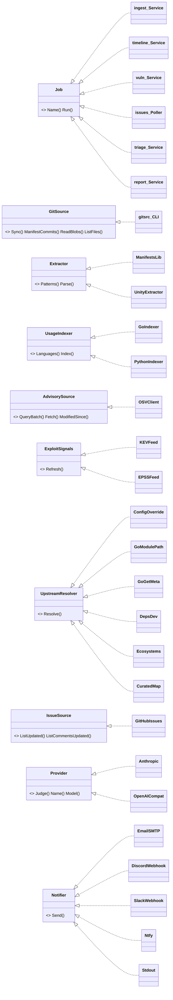

# Outbound interfaces

This document lists the interfaces that services use to reach the outside world, their Go signatures, and the adapters that implement each one. For the layers these sit in, see [architecture.md](architecture.md). For the services behind each outside source, see [external-sources.md](external-sources.md).

Each interface is declared in the package that uses it, which is the Go convention, and implemented in an adapter package. Tests give a service a hand-written fake in place of the real adapter, so no unit test needs the network, a git remote or an API key.

## Interface and implementation diagram



Ten interfaces to the outside, plus `Checker`, which every outbound adapter also implements (not drawn). GitLab and Gitea issue adapters, a release watcher and a Plane notifier are later additions that plug into `IssueSource` and `Notifier` without touching a service.

## Signatures

Types named here are the domain objects described in [domain-model.md](domain-model.md).

```go
// Signatures as designed. Types named here are the domain objects in domain-model.md.

type Job interface {
    Name() string
    Run(ctx context.Context, scope Scope) (Stats, error)        // scope: all repos or one slug
}

type GitSource interface {
    Sync(ctx context.Context, repo TargetRepo) (head string, err error)             // clone or fetch, bare
    ManifestCommits(ctx context.Context, repo TargetRepo, after string, paths []string) ([]Commit, error)
    ReadBlobs(ctx context.Context, repo TargetRepo, refs []BlobRef) ([]Blob, error) // one cat-file --batch
    ListFiles(ctx context.Context, repo TargetRepo, sha string, globs []string) ([]string, error)
}

type Extractor interface {
    Patterns() []string                                          // manifest path globs it understands
    Parse(path string, content []byte) ([]Dependency, error)
}

type UsageIndexer interface {
    Languages() []string
    Index(ctx context.Context, files []Blob, pkgs []Package) ([]SymbolUse, error)
}

type AdvisorySource interface {
    QueryBatch(ctx context.Context, pvs []PackageVersion) ([]AdvisoryRef, error)
    Fetch(ctx context.Context, id string) (Advisory, error)
    ModifiedSince(ctx context.Context, ecosystem string, t time.Time) ([]AdvisoryRef, error)
}

type ExploitSignals interface {                                   // KEV, EPSS
    Refresh(ctx context.Context) ([]Signal, error)                // keyed by CVE alias
}

type UpstreamResolver interface {
    Resolve(ctx context.Context, p Package, version string) (link UpstreamLink, found bool, err error)
}

type IssueSource interface {
    ListUpdated(ctx context.Context, repo UpstreamRepo, since time.Time, etag string) (IssuePage, error)
    ListCommentsUpdated(ctx context.Context, repo UpstreamRepo, since time.Time, etag string) (CommentPage, error)
}

type Provider interface {
    Judge(ctx context.Context, req JudgeRequest) (JudgeResponse, Usage, error)
    Name() string
    Model() string
}

type Notifier interface {
    Send(ctx context.Context, d Digest) error
}

type Checker interface {
    Check(ctx context.Context) error                          // cheap reachability and auth probe; never mutates
}

// KeySource returns the current LLM key. Each provider adapter is built with one
// and calls it on every Judge and Check. cmd/upw wires it.
type KeySource func(ctx context.Context) (model.Secret, error)
```

`Judge` returns `(JudgeResponse, Usage, error)`. Besides the parsed verdict fields, `JudgeResponse` carries two extra fields, `RequestPayload` and `RawResponse`: the exact bytes sent to the provider and received from it. Triage stores them as `llm_verdicts.request_payload` and `raw_response`.

`Checker` is implemented by every outbound adapter (git, HTTP sources, LLM providers, notifiers) and is what `upw doctor` calls. It does not need its own box in the class diagram.

The LLM key has one seam. `cmd/upw` builds the `KeySource`: the `UPW_LLM_API_KEY` variable if set, otherwise `settings.Service`, which is the only code that encrypts and decrypts the stored key. Because the adapter calls it on every `Judge` and `Check`, a key saved in the web UI works without a restart. `triage` does not use `SettingsStore` and never sees the key; only `settings.Service` does, and the store holds ciphertext only.

`eval` declares its own small interface for "judge this candidate", which `triage.Service` satisfies; `cmd/upw` wires them. So `eval` imports `model` only and does not import `triage`.

## Implementations

| Interface | Implementations | Notes |
|---|---|---|
| `Job` | `ingest.Service`, `timeline.Service`, `vuln.Service`, `issues.Poller`, `triage.Service`, `report.Service` | `usage.Service`, `upstream.Service`, `prefilter.Service` and `ops.Backup` are also jobs; the diagram shows the main ones. See the job table in [architecture.md](architecture.md). |
| `GitSource` | `gitsrc` (shells out to the `git` binary) | Bare clones only. |
| `Extractor` | `manifests` library adapter, Unity extractor | The Unity extractor reads `Packages/manifest.json`, `Packages/packages-lock.json` and `ProjectSettings/ProjectVersion.txt`. |
| `UsageIndexer` | Go indexer (`go/parser`), Python indexer (import scan) | No type-checking in the MVP. |
| `AdvisorySource` | OSV client | API for per-version queries, bucket for daily deltas. |
| `ExploitSignals` | CISA KEV feed, EPSS feed | Both keyed by CVE alias. |
| `UpstreamResolver` | config override, Go module path, go-get meta, deps.dev, ecosyste.ms, curated map | A chain; the first hit wins. |
| `IssueSource` | GitHub issues | GitLab and Gitea come later. |
| `Provider` | Anthropic (`internal/llm/anthropic`), OpenAI-compatible (`internal/llm/openaicompat`, config value `openai_compat`) | One provider is chosen in config. Declared in `internal/triage`; `internal/llm` is a pure helper package (provider-neutral prompt builder, vocabulary constants, output schema, cost helpers) that imports `model` only. Each adapter is built with a `KeySource`. The eval service reaches triage through its own interface, not a provider. |
| `Notifier` | email (SMTP), Discord webhook, Slack webhook, ntfy, stdout | Several can be enabled at once. |
| `Checker` | every outbound adapter above | Called by `upw doctor`. |

The email notifier uses the standard library `net/smtp` and builds the message itself, so it adds no dependency. Its config holds host, port, username, from and to. The password comes from an environment variable. See [external-sources.md](external-sources.md).

## One consequence of bare clones

The plan forbids checking out working trees, so the symbol index cannot walk a directory. It reads source files at HEAD through `GitSource.ListFiles` and `ReadBlobs` and hands the bytes to the indexer. That keeps "nothing from a target is ever executed or written to disk as a tree" true.
